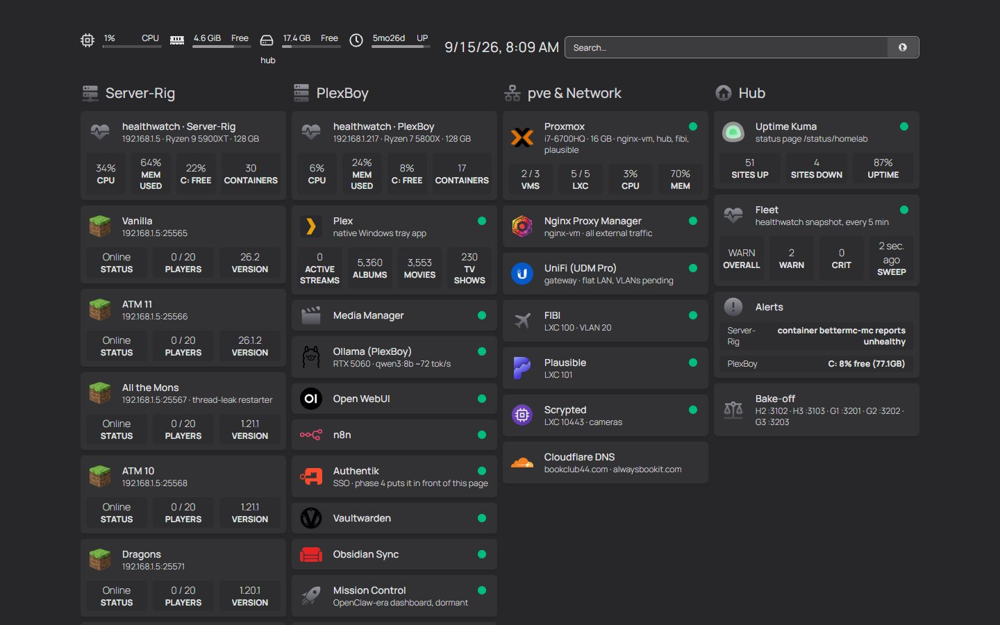
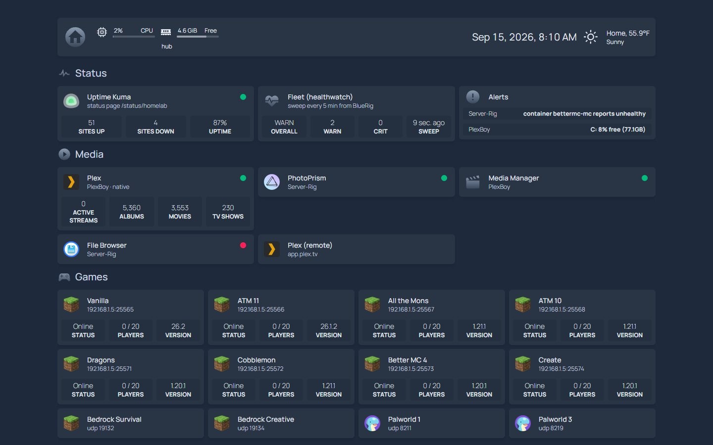
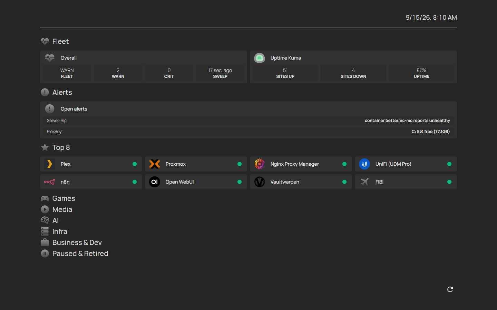
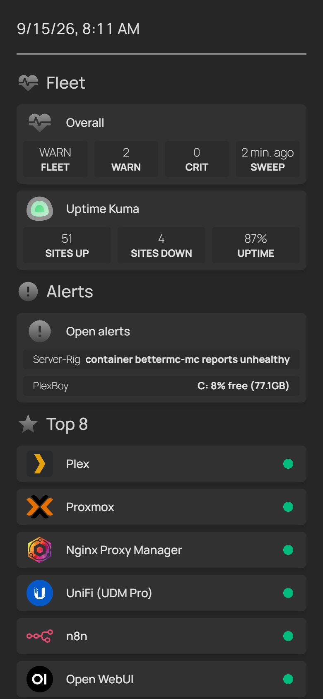
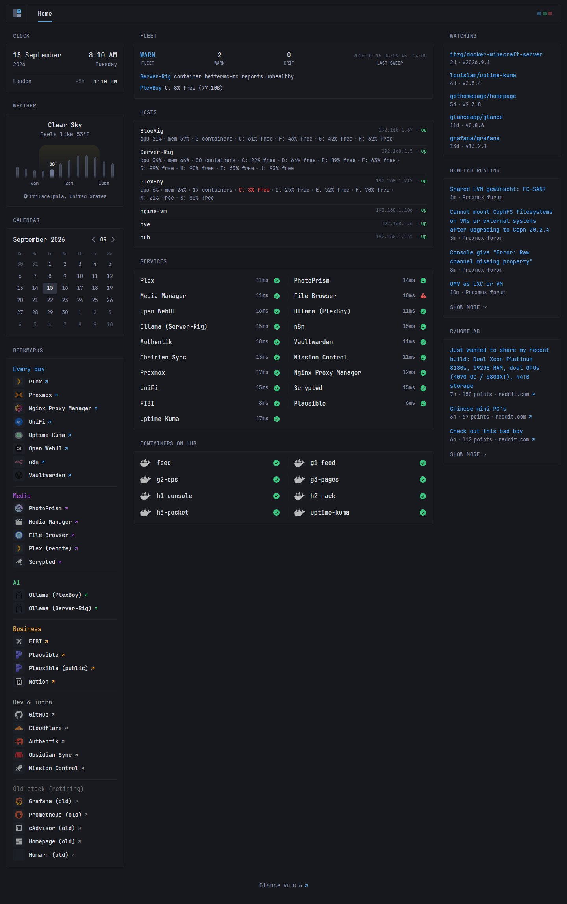
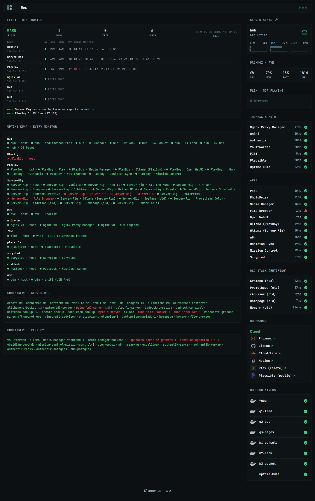
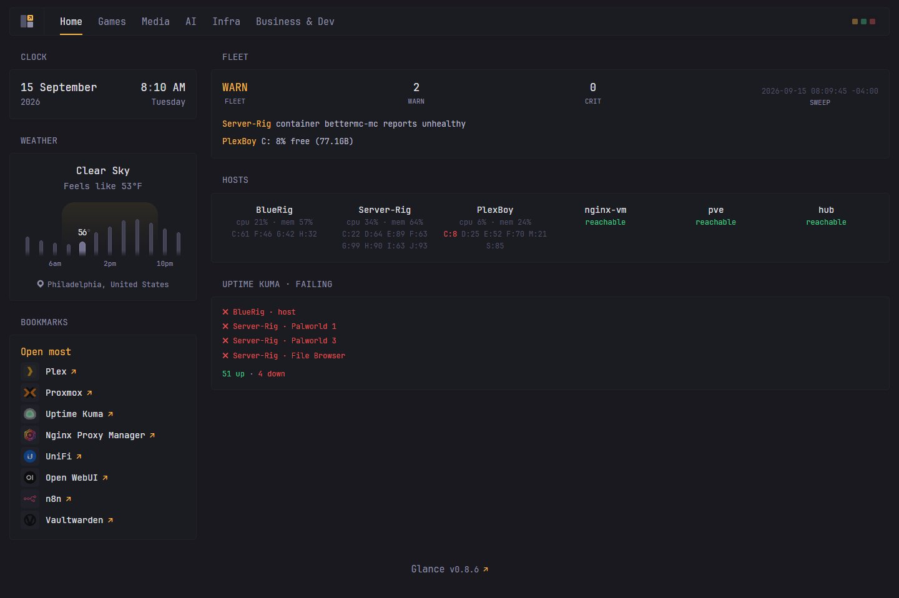
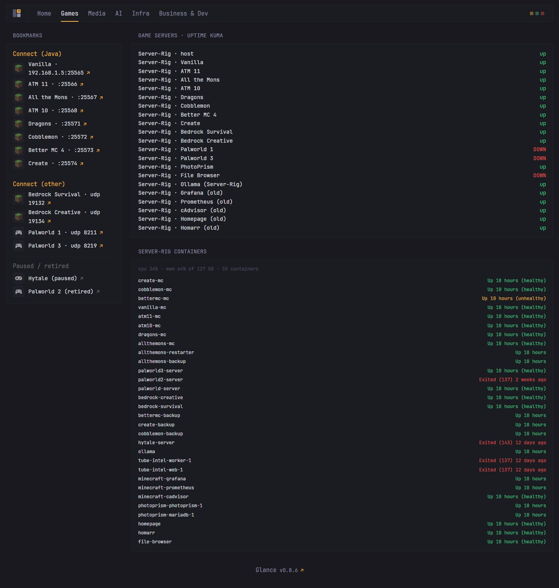

# Bake-off — six front doors, one hub

*Built 2026-09-15. All six run on hub (192.168.1.141), read the same Uptime Kuma
(55 monitors) and the same healthwatch feed (every 5 min). Screenshots in
`docs/screenshots/phase-1/`, taken at 1440×900 and 390×844 with `ops/shoot.mjs`.*

## What every variant gets for free

- **healthwatch feed** — per-host CPU, memory, every disk's free %, container list with
  health and restart counts, open alerts, sweep time. PlexBoy's C: at 8% renders red everywhere.
- **Uptime Kuma** — 55 monitors: ping per host, HTTP per service, real game-protocol
  checks for all 8 Minecraft Java servers and both Bedrock servers (a server that accepts
  TCP but won't handshake shows DOWN, the lesson from the AtM zombie of 09-02).
- **Read-only integrations** — Proxmox (PVEAuditor token), Plex (token).
- All 29 live linkable services (`ops/check-inventory.py` passes for all six).

## What none of them have yet (phase 2)

- Docker container widgets for PlexBoy and Server-Rig need a read-only socket proxy on each
  host (plus a Hyper-V firewall rule on Server-Rig). Today only hub's own containers show in
  the native Docker widgets; the healthwatch feed already carries every container on every host.
- UniFi widget: needs the read-only local user (on Chris).
- Discord alerts: need the webhook (on Chris).

## Red monitors at capture time, and why

| Monitor | Why | Action |
|---|---|---|
| BlueRig · host | BlueRig's Windows firewall drops ICMP echo (PlexBoy and Server-Rig answer). healthwatch itself proves BlueRig is up. | Allow "File and Printer Sharing (Echo Request – ICMPv4-In)" on BlueRig, or drop the ping monitor. |
| Server-Rig · File Browser | **Genuinely broken.** Compose publishes `8085→85` but filebrowser listens on 80. TCP accepts, HTTP resets. Has been like this for a while; healthwatch only checked the port. | Fix the port map in the file-browser compose on Server-Rig. |
| Server-Rig · Palworld 1 / 3 | Neither probe answers: gamedig's `palworld` needs the REST API (off), and Steam A2S on 27015 / 27017 is silent. Monitors paused; the Docker healthcheck in the feed (`palworld-server` healthy) is the signal. | Enable the REST API on both servers if you want an external probe. |

`bettermc-mc` reports unhealthy in Docker (feed alert) while its Minecraft handshake
succeeds. Known false-positive pattern from August; watch, don't act.

---

## H1 Console — Homepage, one column per machine

**Shows live:** healthwatch card per machine (CPU / mem / C: free / container count), 8
Minecraft cards with players + version, Proxmox (VMs, LXCs, CPU, mem), Plex library counts,
Kuma summary, alert list, Prometheus targets. Machine columns: Server-Rig, PlexBoy, pve &
Network, Hub, BlueRig.

**Pros** — densest information per screen; "where does X run" is the organizing question, which
matches how you SSH around. Everything has a status dot.
**Cons** — five columns wrap to 4+1 at 1440px; the BlueRig column is thin; on a phone it's a
very long scroll. Retiring services still take space in the columns.

## H2 Rack — Homepage, grouped by function

**Shows live:** same widgets as H1, but Status row on top (Kuma, fleet, alerts), then Media,
Games (4-wide grid of Minecraft cards), AI, Infra, Business, Dev, Family, Paused & Retired.
Boxed header with weather.

**Pros** — best desktop read: scan rows top to bottom, games grid is the nicest thing on any
of the six. Function grouping survives moving a service between machines.
**Cons** — no per-machine health at a glance (that's in H1); Infra row mixes real infra with
the retiring old stack.

## H3 Pocket — Homepage, phone-first

**Shows live:** Fleet strip (overall / warn / crit / sweep age) + Kuma up-down, open alerts as a
list, Top 8 with status dots. Games, Media, AI, Infra, Business & Dev, Paused & Retired start
collapsed, one tap each.

**Pros** — the 3-second read on a phone actually works: two alerts, eight links, done. Least
noise. Best candidate for the "at Lockheed" use case.
**Cons** — on a desktop it's under-using the screen; you'll want H1/H2 density at home.

## G1 Feed — Glance start page

**Shows live:** fleet + alerts, a hosts list with every disk %, a compact 19-site monitor,
hub containers, plus clock (with London), weather, calendar, release watch (Glance, Homepage,
Kuma, itzg MC image, Grafana), selfh.st + Grafana + Proxmox RSS, r/homelab.

**Pros** — pleasant to leave open all day; the release watcher is genuinely useful for a
Docker fleet; bookmark column with colored groups is a fast link wall.
**Cons** — no Minecraft player counts or Proxmox/Plex depth (Glance has no native widgets for
them; G2 shows they can be done with custom-api). Monitor widget is HTTP-only.

## G2 Ops — Glance as a console

**Shows live:** fleet table (host / up / cpu / mem / containers / every disk, red under 10%),
**every Kuma monitor** with its current beat (via the status-page API + heartbeat subrequest),
Server-Rig and PlexBoy container lists colored by health with restart counts, hub server
stats, Proxmox node stats from the API, Plex now-playing from the API, three compact
monitor groups, bookmarks, hub containers.

**Pros** — the most information of the six, and all of it from three JSON sources; proves
Glance's custom-api can replace most Homepage widgets. Wide layout.
**Cons** — desktop-only in practice (the table crushes at 390px); templates are Go text/template,
so every panel is code you maintain; Kuma names repeat the host prefix.

## G3 Pages — Glance, one page per domain

**Shows live:** Home = fleet, hosts, failing monitors, 8 links. Games = Kuma status for every
Server-Rig monitor + all 30 Server-Rig containers with health. Media = Plex now-playing,
PlexBoy disks, media monitors. AI = monitors + PlexBoy's Ollama model list. Infra = Proxmox
stats, hub stats, monitors, hub containers. Business & Dev = monitors + release watch.

**Pros** — each page is complete for its domain and the Home page is as calm as H3; the Games
page is what the kids would want. Navigation scales as services grow.
**Cons** — two clicks to some things; same template-maintenance cost as G2; Glance has no
"collapse" so pages are the only density control.

---

## Scoring (1–5, higher is better)

| | H1 Console | H2 Rack | H3 Pocket | G1 Feed | G2 Ops | G3 Pages |
|---|---|---|---|---|---|---|
| Glanceability (is anything on fire?) | 3 | 4 | **5** | 4 | 4 | **5** |
| Density at a desk | **5** | 4 | 2 | 3 | **5** | 4 |
| Phone | 2 | 3 | **5** | 3 | 1 | 4 |
| Live data depth today | 4 | 4 | 3 | 3 | **5** | 4 |
| Config effort to maintain | 3 | 3 | 4 | **5** | 2 | 3 |
| Room to grow (widgets, integrations) | **5** | **5** | 4 | 3 | 4 | 4 |
| Looks like a place you'd want to live | 3 | 4 | 4 | **5** | 4 | 4 |

## My read (one paragraph, then it's yours)

The two ideas that survived contact were **H3's "alerts, then eight links"** for the phone and
**H2's function rows** for the desk; Homepage can do both in one config (H3 layout with
`initiallyCollapsed` off on large screens is not a thing, but two Homepage instances sharing
`services.yaml` is trivial). On the Glance side, **G2 proved the platform can match Homepage on
ops data**, but at the cost of owning Go templates; **G3** is the better Glance pick because
the Home page is calm and the Games page is the best game-server view of the six. If you want
one answer: H2 for the desk, and lift H3's Fleet/Alerts/Top-8 block to the top of it.
